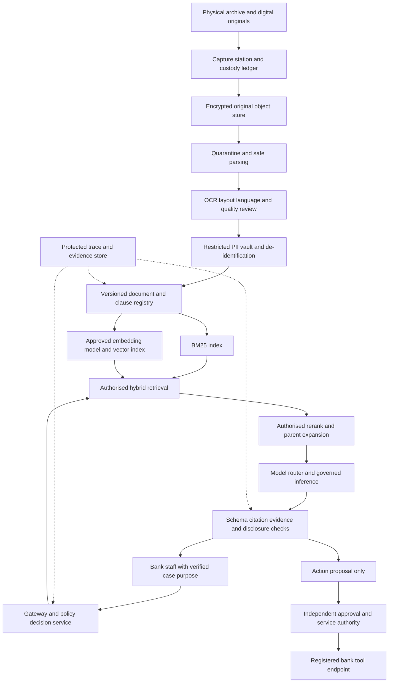

# 02 — Enterprise architecture and trust boundaries

Use a bank-controlled data plane with an isolated document-processing plane, an online knowledge plane and an independent policy/authority plane. A multi-region deployment is allowed only inside the approved placement boundary. Offline or restricted-connectivity deployment needs separately admitted packages, models, keys and local identity dependencies.

### Component contracts

**Capture:** custody manifests bind physical box, folio, operator, scan batch and hashes. The original remains immutable where an approved hold requires it. OCR and redacted derivatives do not overwrite evidence.

**Processing:** queues carry opaque IDs and object references, not raw text. Untrusted PDFs, macros, attachments, links and image metadata are parsed without network access in resource-limited workers. Malware and decompression bombs go to quarantine. Workers use short-lived service grants and cannot administer indexes or key vaults.

**Knowledge:** the registry stores document/parent IDs, versions, page coordinates, language, source type, issuer, effective/superseded dates, custody status, classification, case/customer partitions, grant references, OCR quality and permitted purposes. Documents lacking a trusted owner or grants are unsearchable. Sparse and dense indexes carry corresponding metadata and tombstone epochs.

**Authority:** the gateway authenticates subject, service, tenant, customer/case and purpose. A policy service issues a bounded retrieval grant with a short expiry and permission epoch. Search applies filters before candidates can reach the reranker or model; authorised parent expansion and citation hydration recheck each returned object. Denied objects must not leak through scores, counts, snippets or cached answers. A read-only knowledge grant never becomes a tool-execution grant.

**Answer:** the router receives sanitised query and authorised context only. The final envelope includes answer state, supported claims, document versions, page references, uncertainty and trace ID. An evidence checker can reject absent or incompatible citations. It cannot establish the truth of a forged source merely by checking a citation.

### Lifecycle and recovery

Maintain a durable ingest ledger with idempotent keys and stage transitions: captured → quarantined → parsed → reviewed → indexed → reconciled. Use at-least-once delivery plus idempotent effects; do not claim an exactly-once network. Admission becomes successful only after both indexes, permissions and page-to-chunk lineage reconcile.

Restore a consistent document manifest, policy snapshot, model/prompt release and index generation into a clean environment. Recheck current grants before restored content is answerable. Proposed recovery objectives must be tested; recovery of an index without its tombstones can reintroduce revoked records.
