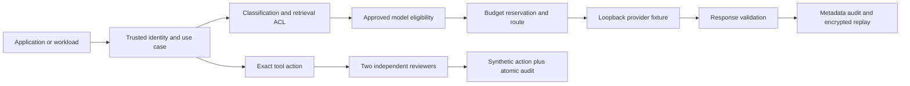

# Enterprise AI Gateway

**Approve the use case. Constrain the route. Preserve the evidence.**

Security reference preview **v0.1.0**, maintained by Ashish Srivastava.

Enterprise applications need a consistent boundary between their users, models, retrieved data and tools. This product turns selected controls into inspectable code and connects the rest to an explicit governance and deployment contract.



## Product capabilities

| Capability | Available in v0.1.0 |
|---|---|
| Governed model access | Server-derived tenant, scoped workload credentials, approved purpose, review expiry and model lifecycle |
| Policy integrity | Ed25519 admission, pinned trust input, site binding and durable revision/digest watermark |
| Routing safety | Classification floor, declared-region eligibility, cost ordering within eligible routes and bounded local fallback |
| RAG boundaries | Synthetic document ACLs, subject checks and classification escalation |
| Agent containment | Tool proposals carry no authority; two independent, action-bound, expiring, single-use approvals |
| Reliability and spend | Real HTTP timeout/malformed-response cases, circuit breaker, transactional demo-credit reservations and attempt limits |
| Privacy and evidence | Metadata-only audit, AES-GCM response replay, subject/tenant isolation and restore/key-loss tests |
| Governance toolkit | 25 risk records, 20 control/test mappings, use-case/model records and expiry-aware example validation |

Run from the repository root:

```sh
python3.12 -m venv .venv
.venv/bin/python -m pip install --require-hashes -r requirements.lock
.venv/bin/python -m aiegateway.demo
```

No provider account or paid model calls are required. [Quickstart](docs/quickstart.md) includes the local HTTP API and isolated container verification.

## Choose an inspection route

| Reader | Start here | Decision it supports |
|---|---|---|
| CEO / CIO | [Executive brief](docs/executive-brief.md) | What to fund and which risk remains |
| CISO / security architect | [Threat model](docs/threat-model.md), [coverage](docs/coverage.md) | Which controls are enforced and where assurance ends |
| Platform / AI engineer | [Architecture](docs/architecture.md), [API](docs/api.md), [reliability](docs/reliability.md) | How to integrate and test a bounded pilot |
| AI governance / model risk | [Governance](docs/governance.md), [framework map](docs/framework-mapping.md) | Who owns approval, evaluation and exceptions |
| Sovereign cloud leader | [Sovereign patterns](docs/sovereign-deployment.md), [large-scale blueprint](docs/large-scale-architecture.md) | What can execute locally and what must be independently verified |

The [complete documentation index](docs/index.md) covers security, governance, operations, industries and lifecycle. [Experiment records](../../evidence/README.md) identify source hashes and limitations.

## Product boundary

This release is a **local, single-node security reference**, with text-only deterministic provider fixtures. Enterprise SSO, real provider adapters, TLS ingress, distributed state, Kubernetes HA, streaming, multimodal processing, MCP/A2A conformance and learned-model evaluations are design or roadmap items. No certification, regulatory compliance, customers, deployment or large-scale throughput is claimed.

Read the [production gate](docs/production-readiness.md) and [known limitations](docs/limitations.md) before using real data. [Release notes](https://github.com/cybersmeashish/enterprise-ai-security-architectures/releases) and [roadmap](docs/roadmap.md) separate shipped behavior from future investment.
