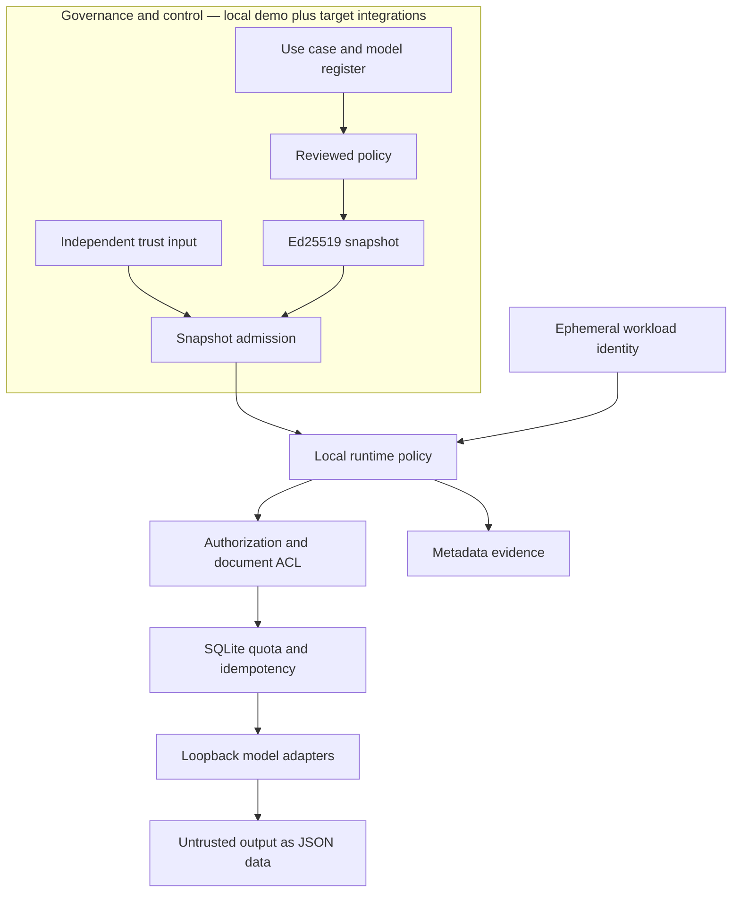

# Logical architecture and actual release boundary

**Implemented:** the gateway process loads an admitted policy snapshot; its synchronous path has no external governance-control-plane call. Trusted principal records establish tenant and scope. The engine resolves a use case, checks document ACLs, computes the minimum classification, filters approved/current models, reserves credits, invokes a bounded adapter and validates the response.

The implementation deliberately separates model text from authority to execute tools. It does not proxy arbitrary URLs or accept client-defined tenant, region, model or provider fields. Unsupported fields fail the strict contract.

**Design:** enterprise identity, signer custody, policy review services, independent evidence checkpoints, provider transports and highly available state. The runtime snapshot can operate without contacting a control plane until policy expiry; this does not demonstrate offline operation of a real cloud model.

Decisions: text-only API; no generic API compatibility claim; no streaming; no semantic cache; declared placement is a routing constraint rather than observed location assurance; byte credits are synthetic.

[Source-to-decision map](source-map.md) · [Large-scale target](large-scale-architecture.md)
