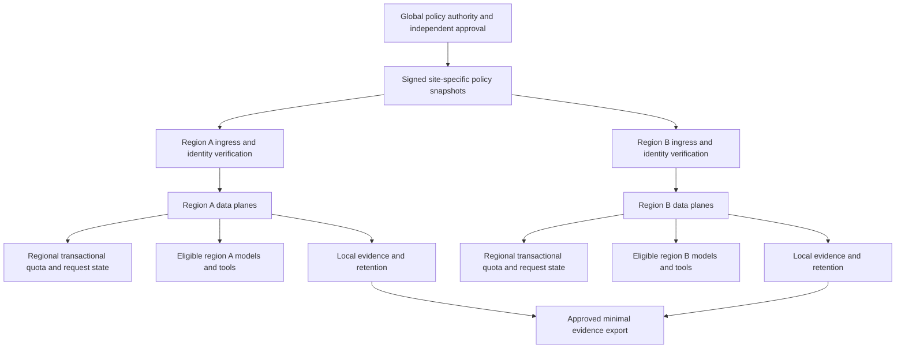

# Large-scale enterprise target architecture

**Stage: design blueprint; not a tested deployment.** The v0.1 runtime is a local single-node fixture.

Keep policy distribution outside the synchronous inference path. Partition data planes by residency, business criticality and tenant risk. Assign budgets to regional authorities before a partition rather than allowing every region to spend the full global budget. Define an atomic reservation invariant and what happens during quorum loss.

| Layer | Target design decision | Required evidence |
|---|---|---|
| Ingress | TLS, identity verification, bounded requests, upstream abuse limits | Issuer/audience/expiry and request-smuggling tests |
| Data plane | Multiple failure domains, bounded concurrency, separate admin plane | Failover, queue saturation and rollback |
| State | HA transactional budgets, idempotency, approvals and policy watermarks | Concurrent and partition invariants; restore with keys |
| Provider egress | Pinned destinations, private endpoints, no arbitrary redirects | DNS, certificate, endpoint identity and declared/observed placement |
| Evidence | Site-local retention, external checkpoint, approved export | Access, truncation, custody, time uncertainty and deletion |
| Operations | Canary, capacity gate, SLO/error budget and recovery ownership | Provider outage, state outage, regional loss and restore exercises |

Capacity must account for input/output bytes, model inference duration, streaming sockets, retry amplification, queue growth and state I/O. Little's Law can inform an initial concurrency hypothesis, but a formula is not a benchmark. Publish hardware, versions, request mix, duration, success/error counts and distributions.

The current measured cohorts are 60 synthetic requests each at concurrency 1, 4 and 8. They do not validate this blueprint or an enterprise throughput claim.
